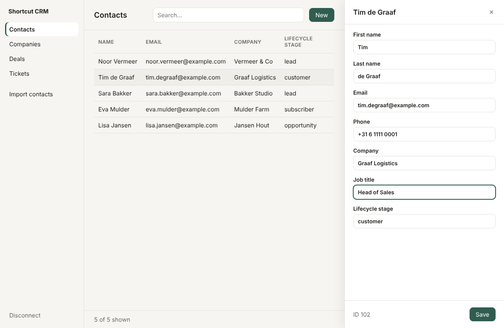

# Shortcut CRM

A desktop app for working with HubSpot without clicking through page after page. Search, view and edit contacts, companies, deals and tickets from one window, and import contacts from a CSV file.



## Why I built it

Updating HubSpot records one by one in the browser takes a lot of clicks. I wanted one screen where I can search, open a record, change a field and save in a few seconds, and drop in a spreadsheet of contacts without cleaning it up first.

## What it does

- **Browse and search** contacts, companies, deals and tickets
- **Edit a record** in a side panel. Only the fields you changed are sent to HubSpot.
- **Create new records**
- **Import contacts from CSV**, with a preview before anything is sent. It handles commas inside quotes, semicolon files from Dutch Excel, and Dutch or English column names. Rows without a valid email, or with an email that appears twice in the file, are skipped and listed with the reason. Rows that HubSpot rejects (for example, a contact that already exists) are reported by line number.

## How your token is handled

- You paste a HubSpot private app token when the app starts.
- It is kept in memory in the main process only. It is not saved to disk, not written to logs, and never passed to the page.
- Disconnecting or closing the app clears it.
- The app only talks to `api.hubapi.com`. There is no server of mine in between.

## Setup

You need [Node.js](https://nodejs.org) 20 or newer and a HubSpot account where you can create a private app (a free developer test account works).

1. In HubSpot go to **Settings → Integrations → Private Apps → Create a private app** and give it these scopes:
   - `crm.objects.contacts.read`, `crm.objects.contacts.write`
   - `crm.objects.companies.read`, `crm.objects.companies.write`
   - `crm.objects.deals.read`, `crm.objects.deals.write`
   - `tickets`
2. Copy the access token.
3. Run the app:

   ```bash
   git clone https://github.com/chamodgimhan/shortcut-crm.git
   cd shortcut-crm
   npm install
   npm start
   ```

4. Paste the token and click **Connect**.

Try the import with the files in `samples/`. All the data in them is made up.

## Build a Windows .exe

```bash
npm run dist
```

This puts a portable `.exe` and an installer in `dist/`.

## Tests

```bash
npm test
```

Covers the CSV parser and the HubSpot client (with HubSpot's API faked, so no token is needed).

## How it's built

```
src/main/main.js      Electron main process: window, and the only code that calls HubSpot
src/main/hubspot.js   Small HubSpot CRM v3 client (list, search, get, update, create, batch import)
src/main/csv.js       CSV parsing and mapping columns to HubSpot fields
src/main/objects.js   Which objects and fields the app shows
src/preload.js        The bridge the page is allowed to use
src/renderer/         The interface (plain HTML, CSS and JavaScript)
```

The page runs with context isolation and sandboxing on, and has no Node access. Everything that touches HubSpot goes through `preload.js` to the main process.

Electron, plain JavaScript, HubSpot CRM API v3.

Personal project. Not affiliated with or endorsed by HubSpot.

## License

MIT
